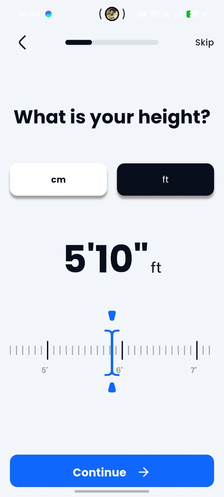
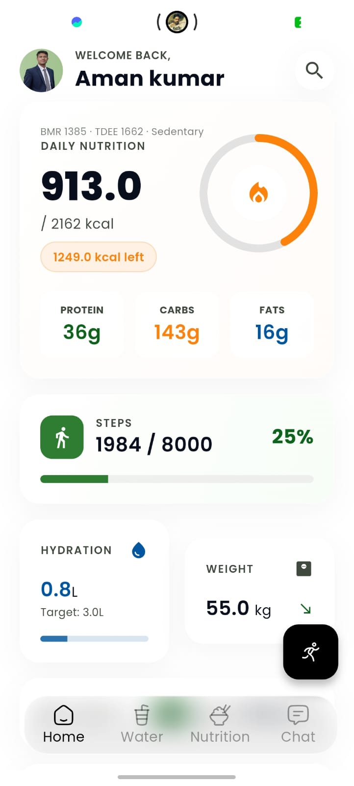
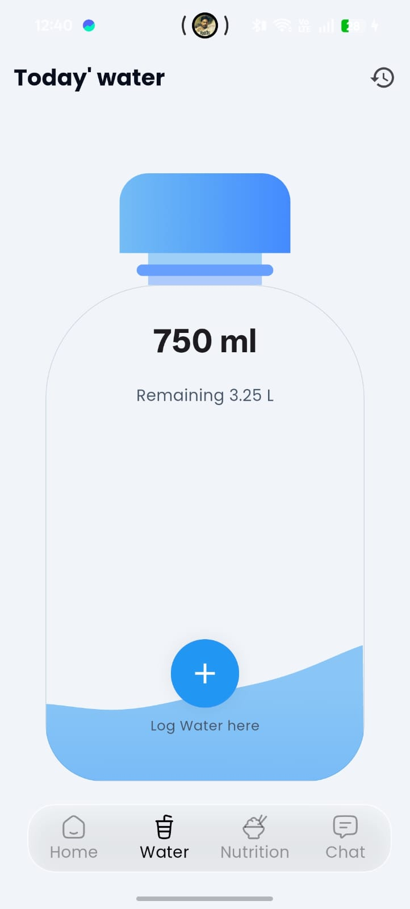
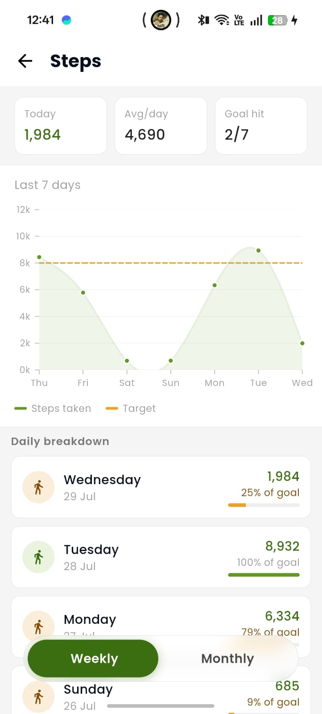
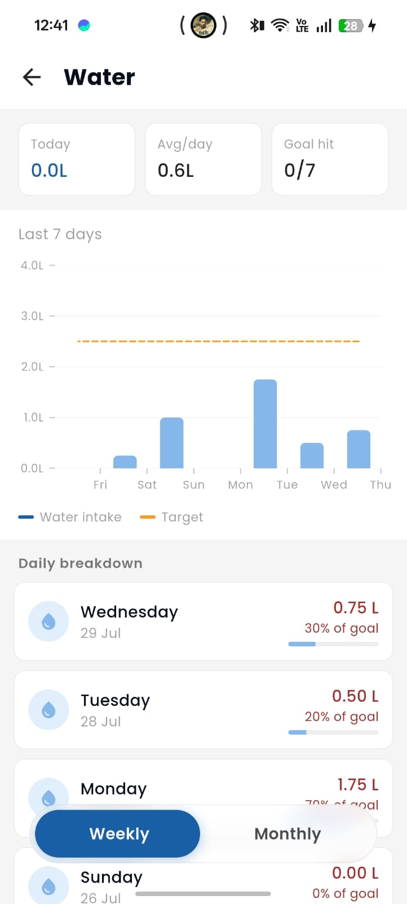
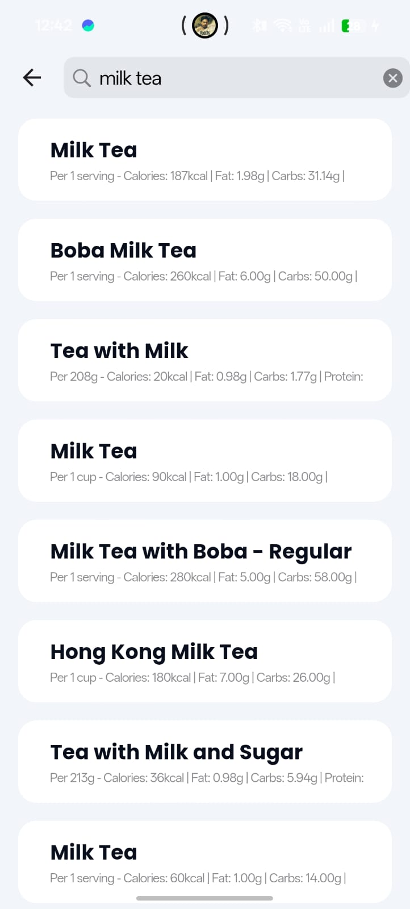
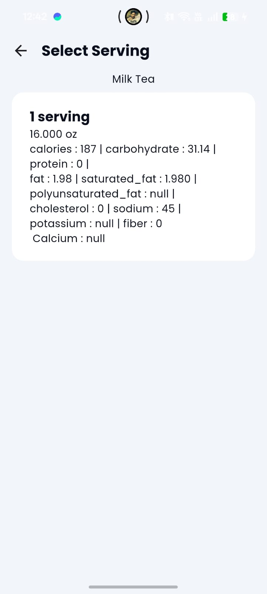

# DOCTO  

### 🩺 Your Comprehensive Health Management App  

aHealth is a Flutter-based application designed to help users take charge of their health. It integrates advanced features like **HealthConnect**, AI-powered nutritional analysis, and seamless syncing with Android and iOS devices. Manage your sleep, steps, water intake, weight, height, and nutrition all in one place, with a user-friendly interface and reliable state management.

---

## 🚀 Features  

- **Health Data Sync:**  
  Sync all your health data with other apps using HealthConnect for Android and iOS.  
- **Sleep Tracking:**  
  Select and manage your sleep sessions with customizable time ranges.  
- **Nutrition Analysis:**  
  Retrieve detailed macronutrient and micronutrient information for foods, with AI-based image recognition to estimate quantity and units.  
- **Activity Monitoring:**  
  Track daily steps, water intake, weight, and height with ease.  
- **Voice Assistant:**(commig soon)  
  Activate the AI assistant by saying, *"Hi Raone"*, and get instant help.  
- **State Management:**  
  Proper state management ensures smooth app performance and data consistency.  

---

## 🛠️ Tech Stack  

- **Frontend:** Flutter   
- **Database:** HIVE, ObjectBox
- **AI Integration:** Google ML Kit  
- **Health Data Integration:** [HealthConnect](https://developer.android.com/guide/health-and-fitness/health-connect)  

---

## 📲 Installation  

1. Clone the repository:  
   git clone https://github.com/your-username/aHealth.git  
   cd aHealth
2. Install dependencies:
    flutter pub get  

3. Add your API keys to the lib/secrets/secrets.dart file.
    const String GEMINI_API_KEY = 'your_api_key_here';  
   Add android/secrets.properties file.
    MAPS_API_KEY=your_google_map_apikey
    
Note: Make sure to exclude this file from Git tracking by adding it to .gitignore.

4. Run the app:
   fvm flutter pub get
   fvm flutter run  

## 🤖 AI Features
  Food Recognition: Use AI to detect nutritional information, including quantities and units like piece, g, or ml.
  Image Processing: Analyze food items from images and calculate micronutrients.

  
## 🔒 Privacy & Permissions
  Access to health data is handled securely, with permissions explicitly requested for each feature.
  The app complies with privacy regulations to ensure your data remains private.
  
## 🛡️ Contributions

We welcome contributions! If you want to improve the app, please:

#Fork the repository.
    Create a new branch:

  git checkout -b feature-name

#Commit changes:

  git commit -m 'Add feature-name'

#Push to the branch:

  git push origin feature-name

#Open a pull request.

## 📸 Screenshots

  
  
  
  
  

  
  
  
  

    
## 📧 Contact

For inquiries, feature requests, or issues, reach out to:

  Name: Aman Kumar
  Email: kumaraman33063@gmail.com

## 🏆 Acknowledgments

  Flutter community for providing an amazing framework.
  HealthConnect for health data integration.
  Google ML Kit for enabling AI features.
  
## Flutter
This project is a starting point for a Flutter application.

A few resources to get you started if this is your first Flutter project:

- [Lab: Write your first Flutter app](https://docs.flutter.dev/get-started/codelab)
- [Cookbook: Useful Flutter samples](https://docs.flutter.dev/cookbook)

For help getting started with Flutter development, view the
[online documentation](https://docs.flutter.dev/), which offers tutorials,
samples, guidance on mobile development, and a full API reference.

npx repomix@latest --ignore "assets/**,**/pubspec.lock,ios/Pods/**,ios/Runner.xcodeproj/**,ios/Runner.xcworkspace/**,graphify-out/cache/**,.fvm/**,.agents/**,android/secrets.properties,lib/secrets/secrets.dart" --style markdown

aws lambda
const axios = require("axios");
const OAuth = require("oauth-1.0a");
const crypto = require("crypto");

// FatSecret endpoint
const FATSECRET_API_URL = "https://platform.fatsecret.com/rest/server.api";

// OAuth setup
const oauth = OAuth({
  consumer: {
    key: process.env.FAT_SECRET_CONSUMER_KEY,
    secret: process.env.FAT_SECRET_CONSUMER_SECRET,
  },
  signature_method: "HMAC-SHA1",
  hash_function(base_string, key) {
    return crypto
      .createHmac("sha1", key)
      .update(base_string)
      .digest("base64");
  },
});

exports.searchFoods = async (event) => {
  try {
    // Query params from request
    const searchExpression = event.queryStringParameters?.q || "apple";
    const pageNumber = event.queryStringParameters?.page || 0;
    const maxResults = event.queryStringParameters?.limit || 20;

    // FatSecret API params
    const params = {
      method: "foods.search",
      search_expression: searchExpression,
      page_number: pageNumber,
      max_results: maxResults,
      food_type:"generic",
      format: "json",
    };

    // OAuth signing
    const requestData = {
      url: FATSECRET_API_URL,
      method: "GET",
      data: params,
    };

    const oauthParams = oauth.authorize(requestData);

    // Merge OAuth params + API params
    const finalParams = {
      ...params,
      ...oauthParams,
    };

    // Call FatSecret
    const response = await axios.get(FATSECRET_API_URL, {
      params: finalParams,
    });

    return {
      statusCode: 200,
      body: JSON.stringify(response.data),
    };
  } catch (error) {
    return {
      statusCode: 500,
      body: JSON.stringify({
        message: "API failed",
        error: error.response?.data || error.message,
      }),
    };
  }
};

/// get food detail by id
exports.getFoodDetails = async (event) => {
  try {
    const foodId = event.queryStringParameters?.foodId;

    if (!foodId) {
      return {
        statusCode: 400,
        body: JSON.stringify({
          message: "foodId not found",
        }),
      };
    }

    // FatSecret params
    const params = {
      method: "food.get.v4",
      food_id: foodId,
      format: "json",
    };

    // OAuth signing
    const requestData = {
      url: FATSECRET_API_URL,
      method: "GET",
      data: params,
    };

    const oauthParams = oauth.authorize(requestData);

    // Merge params
    const finalParams = {
      ...params,
      ...oauthParams,
    };

    // Call FatSecret
    const response = await axios.get(FATSECRET_API_URL, {
      params: finalParams,
    });

    return {
      statusCode: 200,
      body: JSON.stringify(response.data),
    };
  } catch (error) {
    return {
      statusCode: 500,
      body: JSON.stringify({
        message: "Food detail API failed",
        error: error.response?.data || error.message,
      }),
    };
  }
};

const axios = require("axios");
const OAuth = require("oauth-1.0a");
const crypto = require("crypto");

// FatSecret API Endpoint
const FATSECRET_API_URL = "https://platform.fatsecret.com/rest/server.api";

// OAuth setup using HMAC-SHA1
const oauth = OAuth({
  consumer: {
    key: process.env.FAT_SECRET_CONSUMER_KEY,
    secret: process.env.FAT_SECRET_CONSUMER_SECRET,
  },
  signature_method: "HMAC-SHA1",
  hash_function(base_string, key) {
    return crypto
      .createHmac("sha1", key)
      .update(base_string)
      .digest("base64");
  },
});

/**
 * Search Foods Handler (v5)
 * Supports filtering strictly by generic food items.
 */
exports.searchFoods = async (event) => {
  try {
    // Extract query parameters from API Gateway request (e.g., ?q=rice&page=0&limit=20)
    const searchExpression = event.queryStringParameters?.q || "apple";
    const pageNumber = event.queryStringParameters?.page || 0;
    const maxResults = event.queryStringParameters?.limit || 20;

    // Parameters required for FatSecret foods.search.v5
    const params = {
      method: "foods.search.v5",
      search_expression: searchExpression,
      page_number: pageNumber,
      max_results: maxResults,
      food_type: "generic", // Filters results exclusively to generic (non-branded) items
      format: "json",
    };

    // Generate OAuth 1.0a authorization headers/parameters
    const requestData = {
      url: FATSECRET_API_URL,
      method: "GET",
      data: params,
    };

    const oauthParams = oauth.authorize(requestData);

    // Merge API parameters and OAuth signature parameters together
    const finalParams = {
      ...params,
      ...oauthParams,
    };

    // Execute GET request to FatSecret platform
    const response = await axios.get(FATSECRET_API_URL, {
      params: finalParams,
    });

    return {
      statusCode: 200,
      headers: {
        "Content-Type": "application/json",
      },
      body: JSON.stringify(response.data),
    };
  } catch (error) {
    return {
      statusCode: 500,
      headers: {
        "Content-Type": "application/json",
      },
      body: JSON.stringify({
        message: "Search API failed",
        error: error.response?.data || error.message,
      }),
    };
  }
};

/**
 * Get Food Details Handler (v4)
 * Retrieves specific macro/nutrient breakdown for a given food ID.
 */
exports.getFoodDetails = async (event) => {
  try {
    const foodId = event.queryStringParameters?.foodId;

    if (!foodId) {
      return {
        statusCode: 400,
        headers: { "Content-Type": "application/json" },
        body: JSON.stringify({
          message: "foodId parameter is missing",
        }),
      };
    }

    const params = {
      method: "food.get.v4",
      food_id: foodId,
      format: "json",
    };

    const requestData = {
      url: FATSECRET_API_URL,
      method: "GET",
      data: params,
    };

    const oauthParams = oauth.authorize(requestData);

    const finalParams = {
      ...params,
      ...oauthParams,
    };

    const response = await axios.get(FATSECRET_API_URL, {
      params: finalParams,
    });

    return {
      statusCode: 200,
      headers: { "Content-Type": "application/json" },
      body: JSON.stringify(response.data),
    };
  } catch (error) {
    return {
      statusCode: 500,
      headers: { "Content-Type": "application/json" },
      body: JSON.stringify({
        message: "Food detail API failed",
        error: error.response?.data || error.message,
      }),
    };
  }
};
